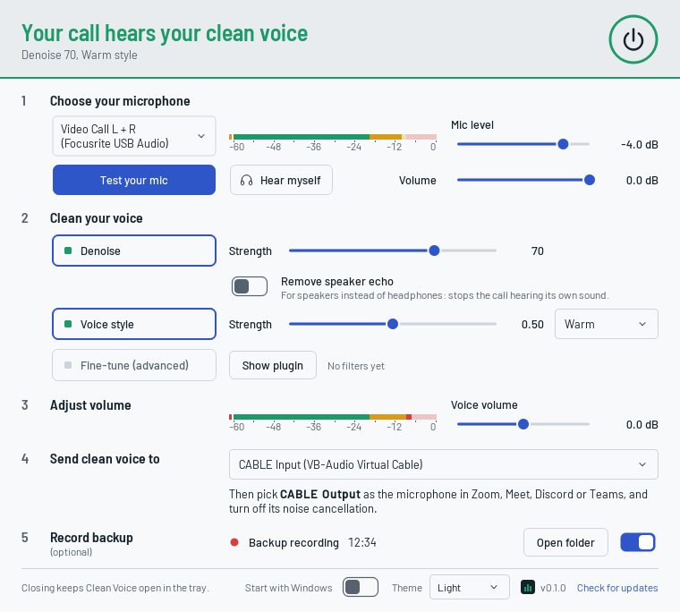

<div align="center">

# Clean Voice

**Sound like you're in a studio, from any microphone.**

Clean Voice removes background noise from your microphone and gives your voice a clear, even sound before it
reaches your call. It's free, made for podcast guests, and needs no audio know-how.

**[Download page](https://paulcaesarflores.github.io/clean-voice/)** · [All releases](https://github.com/paulcaesarflores/clean-voice/releases)

</div>

## Install Clean Voice

Click your computer below to open its steps. Then pick **Way 1** or **Way 2**: both give you the same app.

<details>
<summary><b>Windows</b> (click to open)</summary>

### Way 1: the installer

> **First, turn off Smart App Control.** Clean Voice is safe, free, and its code is public, right here. Windows
> blocks it only because it isn't signed. Signing costs a monthly fee to Microsoft, which this free app doesn't pay.

1. Click the **Start** button, type **Smart App Control**, and open it.
2. Choose **Off**. (Nothing found, or it's already off? Go to step 3. Windows 10 doesn't have it.)
3. Click [**Download for Windows**](https://github.com/paulcaesarflores/clean-voice/releases/latest/download/Clean-Voice-Windows.msi).
4. Open the file you downloaded and follow the installer.
5. If Windows says "Windows protected your PC", click **More info**, then **Run anyway**.

### Way 2: one command

1. Copy this line:

   ```powershell
   irm https://github.com/paulcaesarflores/clean-voice/releases/latest/download/install.ps1 | iex
   ```

2. Right-click the **Start** button and choose **Terminal** (on Windows 10: **Windows PowerShell**).
3. Press **Ctrl+V**, then **Enter**.
4. Wait about 10 minutes. Clean Voice opens by itself. If it stops, do it again.

To remove Clean Voice later, use **Settings → Apps → Installed apps**, as for any app.

</details>

<details>
<summary><b>Mac</b> (click to open)</summary>

### Way 1: the installer

1. Click [**Download for Mac**](https://github.com/paulcaesarflores/clean-voice/releases/latest/download/Clean-Voice-macOS.dmg).
2. Open the file you downloaded and drag **Clean Voice** into **Applications**.
3. Open Clean Voice. If your Mac says it can't open it: **System Settings → Privacy & Security**, scroll down,
   click **Open Anyway**.

### Way 2: one command

1. Copy this line:

   ```bash
   curl -fsSL https://github.com/paulcaesarflores/clean-voice/releases/latest/download/install.sh | bash
   ```

2. Open **Terminal**: press **Cmd+Space**, type **Terminal**, press **Return**.
3. Press **Cmd+V**, then **Return**.
4. If your Mac asks to install developer tools, click **Install**.
5. Wait about 10 minutes. Clean Voice opens by itself. If it stops, do it again.

</details>

## Then set it up in 3 steps

1. **Install VB-CABLE.** It's a free virtual cable from VB-Audio that carries your clean voice into the call app.
   [Download VB-CABLE](https://vb-audio.com/Cable/), install it, then restart your computer.
2. **Open Clean Voice** and pick your microphone.
3. **In your call app** (Google Meet, Zoom, Discord or Teams), choose this as your microphone:
   - **CABLE Output** on Windows
   - **VB-Cable** on Mac

   Then turn off the call app's own noise cancellation: Clean Voice already handles it.

That's it. If Clean Voice's headline says **"Your call hears your clean voice"**, you're ready.

<div align="center">
<picture>
  <source media="(prefers-color-scheme: dark)" srcset="docs/site/running-dark.png">
  
</picture>
</div>

## What it does

One window walks you through five steps, and a power button at the top turns the cleaning on or off.

1. **Choose your microphone.** Watch its level on a dB meter and set **Mic level** so it stays out of the red.
   **Test your mic** records five seconds and plays them back; **Hear myself** lets you listen live in your
   headphones while you set everything up.
2. **Clean your voice.**
   - **Denoise** removes background noise like fans, keyboards, traffic and room hum, using RNNoise.
     **Remove speaker echo** helps if you use speakers instead of headphones (Windows only for now).
   - **Voice style** shapes your voice: Natural, Warm, Crisp, Radio, Deep or Flat, with a strength slider.
   - **Fine-tune (advanced)** opens a filter window that works like OBS Studio's: noise gate, compressor,
     3-band EQ, limiter, expander, gain and more, plus the **VST 2.x plug-ins** you already use in OBS.
3. **Adjust volume.** Set **Voice volume** in dB while watching what the call hears. A limiter keeps you from
   clipping.
4. **Send clean voice to** VB-CABLE, so your call app can pick it up.
5. **Record a backup** (optional): your clean voice and your raw mic as WAV files on your computer, in case the
   call drops.

Light, dark or automatic: pick the look in the window's footer.

Clean Voice works with any app that lets you pick a microphone.

## Requirements

| | Windows | Mac |
| --- | --- | --- |
| System | Windows 10 or 11, 64-bit | macOS 13 Ventura or later, Apple Silicon or Intel |
| Also needed | [VB-CABLE](https://vb-audio.com/Cable/) (free) | [VB-CABLE](https://vb-audio.com/Cable/) (free) |
| Best with | Headphones | Headphones |

## The first-launch warning

Clean Voice is free and isn't signed with a paid certificate, so your computer warns you the first time you open it.
This is expected:

- **Windows Smart App Control:** if Windows blocks Clean Voice, turn Smart App Control off as in the Windows steps
  under [Install Clean Voice](#install-clean-voice). It blocks every unsigned app, however it was installed.
- **Windows:** if you see "Windows protected your PC", click **More info**, then **Run anyway**.
- **Mac:** if you see "Clean Voice can't be opened", open **System Settings → Privacy & Security**, scroll down
  and click **Open Anyway**.

## Privacy

Your voice stays on your computer. Clean Voice does all its processing on your computer and never sends your audio
anywhere. Its only internet connection is the update check, which asks GitHub for the latest version number and
sends no personal data. Backup recordings are saved only on your computer, in your **Music → Clean Voice** folder.

## Need help?

- Clean Voice's headline at the top of the window says what's wrong, and the step that needs you shows what to do.
- Still stuck? [Open an issue](https://github.com/paulcaesarflores/clean-voice/issues) and say what the headline
  shows.

## For developers

Clean Voice is a Python 3.12 app with a Qt (PySide6) interface, packaged with [Briefcase](https://briefcase.readthedocs.io/).

On Windows, in PowerShell or Command Prompt:

```bat
py -3.12 -m venv .venv
.venv\Scripts\python -m pip install --upgrade pip
.venv\Scripts\python -m pip install -e . --group dev
.venv\Scripts\python -m pytest
.venv\Scripts\python -m briefcase dev --no-isolation
```

On a Mac, use `python3.12 -m venv .venv` and `.venv/bin/python` instead.

- `.github/workflows/` builds and checks the Windows MSI and macOS DMG, and runs the install command on Windows and
  macOS.
- `tools/install/` holds the install command's scripts.
- A release is made by pushing a `v*` tag.

## Credits and licence

Clean Voice is released under the [MIT licence](LICENSE).

- Noise removal: [RNNoise](https://github.com/xiph/rnnoise) (BSD).
- Echo removal: WebRTC AEC3, through [pywebrtc-audio](https://pypi.org/project/pywebrtc-audio/).
- Interface: [Qt for Python](https://www.qt.io/qt-for-python) (LGPL).
- The audio processing follows the approach of [OBS Studio](https://obsproject.com/)'s filters.
- VST is a trademark of Steinberg Media Technologies GmbH. Clean Voice hosts VST 2.x plug-ins through
  [vst2sdk](https://github.com/Xaymar/vst2sdk) (BSD), a clean-room description of the interface.
- [VB-CABLE](https://vb-audio.com/Cable/) is made by VB-Audio. It's free, and they welcome donations. Clean Voice
  doesn't include it.
